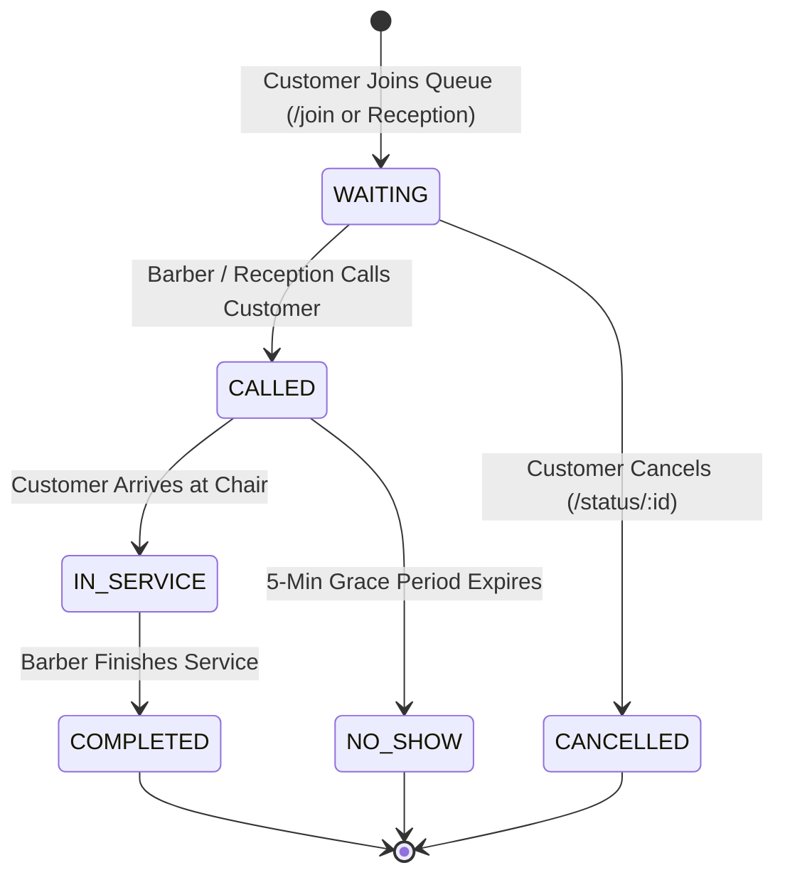

# Flows, Rules & Real-Time Specifications: Salon Queue Management System
**Document ID: DOC-03-FLOWS-RULES**  
**Version:** 1.0.0

---

## 1. Ticket Lifecycle State Machine

### State Definitions:
- `WAITING` (`પ્રતીક્ષામાં`): Ticket created and in line. Wait time actively calculated.
- `CALLED` (`બોલાવવામાં આવેલ`): Barber station is ready; customer notified via screen pulse & TV chime.
- `IN_SERVICE` (`સેવા ચાલુ છે`): Customer is seated in the chair; elapsed timer running.
- `COMPLETED` (`પૂર્ણ થયેલ`): Service finished; chair freed for next patron.
- `CANCELLED` (`રદ કરેલ`): Ticket withdrawn by customer or removed by reception.
- `NO_SHOW` (`ગેરહાજર`): Customer failed to appear within grace window.

---

## 2. Dynamic Wait-Time Estimation Formula

Wait times are computed dynamically based on live chair states and remaining service minutes:

1. **Specific Barber Assigned**:
   $$\text{WaitTime} = \sum_{i \in Q_{\text{barber}}} \text{Duration}(i) + \text{RemainingChairDuration}$$

2. **Any Available Barber ("First Free")**:
   $$\text{WaitTime} = \frac{\sum_{j \in Q_{\text{pool}}} \text{Duration}(j)}{\max(1, N_{\text{active\_barbers}})}$$

3. **Buffer Factor**:
   A +2 minute sanitation/turnaround buffer is appended between consecutive customers.

---

## 3. Real-Time Socket.IO Event Dictionary

| Event Name | Direction | Payload Schema | Trigger Condition |
| :--- | :--- | :--- | :--- |
| `connection` | Client $\leftrightarrow$ Server | `{ socketId: string }` | Client opens websocket connection |
| `queue:subscribe` | Client $\rightarrow$ Server | `{ role: "customer" \| "display" \| "staff", ticketId?: string }` | Client joins specific room channel |
| `queue:state-init` | Server $\rightarrow$ Client | `{ activeQueue: Ticket[], chairs: Barber[], stats: Object }` | Sent immediately upon subscription |
| `queue:ticket-created` | Server $\rightarrow$ Client | `{ ticket: Ticket, newPosition: number }` | Customer joins via web or reception |
| `queue:ticket-updated` | Server $\rightarrow$ Client | `{ ticket: Ticket, updatedFields: Object }` | Status changed, delayed, or reordered |
| `queue:ticket-called` | Server $\rightarrow$ Client | `{ ticket: Ticket, chair: Barber, station: string }` | Barber calls customer; triggers TV chime |
| `queue:ticket-completed`| Server $\rightarrow$ Client | `{ ticketId: string, durationMinutes: number }` | Barber marks service done |
| `barber:status-updated` | Server $\rightarrow$ Client | `{ barberId: string, status: "ACTIVE" \| "BREAK" }` | Barber toggles station availability |

---

## 4. Business Rules & Security

1. **Staff Protection**:
   All `/reception` and `/admin` actions require `X-Staff-Pin` header matching the environment `STAFF_PIN` (default `1234`).
2. **Customer Ticket Privacy**:
   Customers can only modify (delay/cancel) their own ticket via unique UUID/Ticket Token stored in localStorage or URL parameter.
3. **Grace Period**:
   When a ticket status is `CALLED`, the customer has a 5-minute grace period before the reception can mark them as `NO_SHOW`.
4. **Bilingual Formatting**:
   All time estimates and notifications must dynamically provide English ("Approx 15 mins") and Gujarati ("આશરે 15 મિનિટ").
